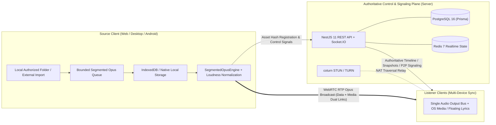

<div align="center">

# Soqaro

**Local-First, Cross-Platform Collaborative Listening Workspace**

Millisecond-level synchronized playback powered by WebRTC RTP Opus and a Segmented Opus engine, keeping all user audio strictly on client devices with zero server audio storage.

[简体中文](./README.md) | [English](./README.en.md)

[](https://github.com/witw123/soqaro/releases/latest)
[](https://github.com/witw123/soqaro/actions/workflows/server-web-ci.yml)
[](https://github.com/witw123/soqaro/actions/workflows/release-desktop.yml)
[](./LICENSE)
[](https://nodejs.org/)
[](https://pnpm.io/)

[Live Web App](https://soqaro.witw.top/app) | [Downloads](#downloads) | [Architecture](#architecture) | [Quick Start](#quick-start) | [Documentation](#documentation) | [Changelog](./CHANGELOG.md)

</div>

---

## Overview

| Capability | Description |
| :--- | :--- |
| **Local-First, Zero Server Audio** | Audio assets stay inside client-authorized directories and IndexedDB storage; the server coordinates only signaling, room state, queues, and authoritative clock sync. |
| **WebRTC RTP Opus Broadcast** | A single designated source device streams audio over WebRTC to all room listeners, preventing playback drift from independent third-party downloads. |
| **Bounded Encoding & CSP Safety** | Browser-side `@audio/opus-encode` uses a bounded encoding queue with concurrency throttling, task cancellation, and strict CSP compatibility (no `unsafe-eval`) to prevent OOM crashes during batch imports. |
| **Three Room Topologies** | **Interactive** (collaborative shared queue, reordering, skip voting), **Request** (listener song requests moderated by host), and **Radio** (continuous preference-driven playback). |
| **Background Continuity (Away Room)** | Room playback continues smoothly via a persistent runtime while navigating the lobby, playlists, or profile pages, with a floating quick-return bar. |
| **Native OS System Bridges** | Desktop integrates Windows SMTC, Linux MPRIS, macOS Now Playing, and an always-on-top floating lyrics window; Android integrates native MediaSession, lockscreen controls, foreground service, and wake locks. |
| **Bilingual Lyrics & Loudness** | Synchronized LRC and verbatim YRC lyrics with translations, romanized pronunciation, EBU R128 loudness normalization, and Merkle hash asset verification. |
| **Resilient Offline Fallback** | Seamless degradation when a source peer drops, allowing listeners holding verified local caches to continue playback. |

---

## Downloads

Current stable release: **[Soqaro v1.0.1](https://github.com/witw123/soqaro/releases/tag/v1.0.1)** (With in-app auto-update support)

| Platform | Architecture | Package | Direct Link | Highlights |
| :--- | :--- | :--- | :--- | :--- |
| **Windows** | x64 | NSIS Installer (`.exe`) | [Soqaro_1.0.1_x64-setup.exe](https://github.com/witw123/soqaro/releases/latest/download/Soqaro_1.0.1_x64-setup.exe) | Windows SMTC integration and floating lyrics |
| **Windows** | x64 | WiX Installer (`.msi`) | [Soqaro_1.0.1_x64_en-US.msi](https://github.com/witw123/soqaro/releases/latest/download/Soqaro_1.0.1_x64_en-US.msi) | Silent installation and enterprise deployment |
| **macOS** | Universal | DMG Image (`.dmg`) | [Soqaro_1.0.1_universal.dmg](https://github.com/witw123/soqaro/releases/latest/download/Soqaro_1.0.1_universal.dmg) | Universal binary for Apple Silicon and Intel |
| **Linux** | x86_64 | AppImage | [Soqaro_1.0.1_amd64.AppImage](https://github.com/witw123/soqaro/releases/latest/download/Soqaro_1.0.1_amd64.AppImage) | Portable standalone binary with MPRIS |
| **Linux** | x86_64 | Debian (`.deb`) / RPM (`.rpm`) | [.deb](https://github.com/witw123/soqaro/releases/latest/download/Soqaro_1.0.1_amd64.deb) / [.rpm](https://github.com/witw123/soqaro/releases/latest/download/Soqaro-1.0.1-1.x86_64.rpm) | Ubuntu, Debian, Fedora, RHEL, openSUSE |
| **Android** | Universal | APK Package (`.apk`) | [Soqaro-Android-v1.0.1.apk](https://github.com/witw123/soqaro/releases/latest/download/Soqaro-Android-v1.0.1.apk) | Native MediaSession, foreground service, in-app APK updater |
| **Web / PWA** | Modern Browsers | Live App | [https://soqaro.witw.top/app](https://soqaro.witw.top/app) | Installable PWA across desktop and mobile browsers |

<details>
<summary>Platform Installation Notes</summary>

- **macOS**: If Gatekeeper blocks first launch, run `sudo xattr -cr /Applications/Soqaro.app` in Terminal.
- **Linux AppImage**: Make executable before launching: `chmod +x Soqaro_1.0.1_amd64.AppImage`.
- **Android**: Release APKs are signed with the release upload key. Grant "Install unknown apps" permission when prompted on first install; subsequent releases can be downloaded and installed in-app.
- **Desktop Auto-Updater**: Signed updater archives (including `Soqaro_universal.app.tar.gz`) and `latest.json` metadata are generated automatically by the release workflow.

</details>

---

## Architecture



### Tech Stack

| Layer | Technologies |
| :--- | :--- |
| **Web & PWA** | Next.js 15, React, TypeScript, Radix UI, Tailwind CSS, TanStack Query |
| **Desktop Shell** | Tauri 2 (Rust), `souvlaki` (SMTC / MPRIS / Now Playing), native floating lyrics window |
| **Mobile Shell** | Capacitor 7 (Android), native `MediaSession`, foreground keep-alive service, APK updater |
| **Backend & Signaling** | NestJS 11, Socket.IO, Prisma ORM, PostgreSQL 16, Redis 7, Zod |
| **Audio & Realtime P2P** | Web Audio API, `@audio/opus-encode`, WebRTC Dual-Link (Data + Media), `coturn` |
| **Tooling & QA** | pnpm 10 Workspaces, Turborepo, Vitest, Jest, Playwright, ESLint 9, Docker Compose |

---

## Quick Start

### Prerequisites

| Component | Recommended | Purpose |
| :--- | :--- | :--- |
| **Node.js** | `22.x` | Web and server runtime |
| **pnpm** | `10.0.0` | Monorepo package manager |
| **PostgreSQL** | `16.x` | Users, rooms, playlists, and track metadata |
| **Redis** | `7.x` | Realtime playback state, leases, and broadcast coordination |
| **Docker** | Latest stable | Containerized PostgreSQL, Redis, and coturn |

### Local Development

1. **Install dependencies and create environment config**

```bash
pnpm install
cp .env.example .env
# In Windows PowerShell:
# Copy-Item .env.example .env
```

2. **Start database services and push schema**

```bash
docker compose up -d postgres redis
pnpm --filter @soqaro/server db:push
```

> Note: [docker-compose.yml](./docker-compose.yml) starts Redis with `--requirepass ${REDIS_PASSWORD}`. Make sure `REDIS_URL` in `.env` includes the matching password (for example, `redis://:your-password@localhost:6379`).

3. **Launch development servers**

```bash
pnpm dev
```

Default endpoints: Web client at `http://localhost:3000`, API and Socket.IO server at `http://localhost:3001`.

### Common Scripts

```bash
pnpm build            # Build all workspace packages and apps
pnpm lint             # Run ESLint with --max-warnings=0
pnpm typecheck        # Run TypeScript type checks across workspaces
pnpm test             # Run unit tests (shared, opus-encode, web, server)
pnpm e2e              # Run Playwright end-to-end tests
pnpm desktop:dev      # Launch Tauri 2 desktop development window
pnpm desktop:build    # Build Tauri desktop installers locally
pnpm mobile:sync      # Sync Web and Capacitor config to native mobile projects
```

---

## Deployment

Production templates and automation scripts are included in the repository:

- Containers: [docker-compose.yml](./docker-compose.yml), [Dockerfile.server](./Dockerfile.server), [Dockerfile.web](./Dockerfile.web)
- System & observability configs: [deploy/linux](./deploy/linux), [deploy/observability](./deploy/observability), [scripts/deploy-check.mjs](./scripts/deploy-check.mjs)
- See [Production Deployment Guide](./docs/deployment/deployment.md) and [TURN Network Checklist](./docs/deploy/turn-network-checklist.md) for full instructions.

---

## Monorepo Layout

```text
soqaro/
├── apps/
│   ├── web/              # Next.js 15 Web/PWA client, audio engine, WebRTC, and diagnostics
│   ├── server/           # NestJS 11 REST API, Prisma persistence, Socket.IO gateway
│   ├── desktop/          # Tauri 2 desktop shell (Rust media controls, downloader, lyrics window)
│   └── mobile/           # Capacitor 7 Android shell (MediaSession, keep-alive, app updater)
├── packages/
│   ├── shared/           # Shared domain models, Zod contracts, and error codes
│   ├── opus-encode/      # CSP-safe Ogg Opus encoder for browser Web Workers / main thread
│   ├── config-eslint/    # Shared ESLint 9 configuration
│   └── config-typescript/# Shared TypeScript base configs
├── deploy/               # Linux systemd/Nginx templates and observability stack
├── docs/                 # Architecture specs, API docs, refactor logs, and ops playbooks
├── scripts/              # Toolchain checks, deployment validation, and changelog extraction
├── CHANGELOG.md          # Release changelog
├── DESIGN.md             # Visual and interaction design guidelines
└── PRODUCT.md            # Product specification
```

---

## Documentation

- [Architecture Overview](./docs/architecture/overview.md)
- [Playback Synchronization Architecture](./docs/architecture/playback-sync.md)
- [P2P Audio Distribution](./docs/architecture/p2p-distribution.md)
- [Local Storage Repository](./docs/architecture/local-storage.md)
- [API and WebSocket Specifications](./docs/api/README.md)
- [Android Release & Signing Guide](./docs/deploy/android-release.md)
- [Observability & Risk Controls](./docs/deployment/observability.md)

---

## License

Released under the [MIT License](./LICENSE).
