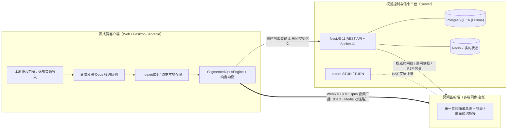

<div align="center">

# Soqaro

**跨平台协同听歌平台**

[简体中文](./README.md) | [English](./README.en.md)

[](https://github.com/witw123/soqaro/releases/latest)
[](https://github.com/witw123/soqaro/actions/workflows/server-web-ci.yml)
[](https://github.com/witw123/soqaro/actions/workflows/release-desktop.yml)
[](./LICENSE)
[](https://nodejs.org/)
[](https://pnpm.io/)

[在线体验](https://soqaro.witw.top/app) | [客户端下载](#客户端下载) | [系统架构](#系统架构) | [快速开始](#快速开始) | [工程文档](#工程文档) | [更新日志](./CHANGELOG.md)

</div>

---

## 核心特性

| 维度 | 能力说明 |
| :--- | :--- |
| **本地优先，零服务端音频存储** | 音频读取自客户端授权本地目录或 IndexedDB 缓存，服务端仅负责信令、房间状态、队列与权威时钟校准。 |
| **WebRTC RTP Opus 同步广播** | 曲目源成员以单一路音频输出总线推流至房间各监听端，避免多端各自直连解码导致的时钟漂移。 |
| **分段转码与 OOM 防护** | 浏览器侧集成受限分段 Opus 转码队列（`@audio/opus-encode`），支持取消任务、并发限流与严格 CSP 无 `unsafe-eval` 运行，防止批量导入崩溃。 |
| **三种房间协同模式** | 支持**协作房（Interactive）**共享点歌与拖拽排序、**点歌台（Request）**观众点歌经房主审核入队、**漫游电台（Radio）**基于偏好的连续播放。 |
| **跨页面持久收听（Away Room）** | 切出房间浏览大厅、歌单或个人页时，房间运行时保持后台连接与音频续播，并保留一键返回入口。 |
| **全平台原生系统桥接** | 桌面端接入 Windows SMTC、Linux MPRIS、macOS Now Playing 及置顶悬浮逐字歌词窗口；Android 端接入原生 MediaSession、锁屏播控、前台服务与唤醒保活。 |
| **多源与双语歌词** | 支持本地曲库扫描、网易云音乐 / QQ 音乐 / 哔哩哔哩导入与版权互补匹配，支持 LRC / YRC 逐字高亮、翻译与罗马音注音。 |
| **断线降级与离线缓存续播** | 支持 EBU R128 响度归一化、资产分片哈希完整性校验，以及监听端存在本地缓存时的离线续播兼容。 |

---

## 客户端下载

当前稳定版本：**[Soqaro v1.0.1](https://github.com/witw123/soqaro/releases/tag/v1.0.1)**（支持桌面端与应用内自动更新）

| 平台 | 架构 | 安装包格式 | 下载链接 | 原生特性 |
| :--- | :--- | :--- | :--- | :--- |
| **Windows** | x64 | NSIS 安装包 (`.exe`) | [Soqaro_1.0.1_x64-setup.exe](https://github.com/witw123/soqaro/releases/latest/download/Soqaro_1.0.1_x64-setup.exe) | 系统媒体控制 (SMTC) 与桌面悬浮歌词 |
| **Windows** | x64 | WiX 安装包 (`.msi`) | [Soqaro_1.0.1_x64_en-US.msi](https://github.com/witw123/soqaro/releases/latest/download/Soqaro_1.0.1_x64_en-US.msi) | 静默安装与企业环境分发 |
| **macOS** | Universal | DMG 镜像 (`.dmg`) | [Soqaro_1.0.1_universal.dmg](https://github.com/witw123/soqaro/releases/latest/download/Soqaro_1.0.1_universal.dmg) | 原生双架构支持 Apple Silicon 与 Intel |
| **Linux** | x86_64 | AppImage | [Soqaro_1.0.1_amd64.AppImage](https://github.com/witw123/soqaro/releases/latest/download/Soqaro_1.0.1_amd64.AppImage) | 免安装便携运行，支持 MPRIS |
| **Linux** | x86_64 | Debian (`.deb`) / RPM (`.rpm`) | [.deb](https://github.com/witw123/soqaro/releases/latest/download/Soqaro_1.0.1_amd64.deb) / [.rpm](https://github.com/witw123/soqaro/releases/latest/download/Soqaro-1.0.1-1.x86_64.rpm) | 适配 Ubuntu / Debian / Fedora / RHEL 等发行版 |
| **Android** | Universal | APK 安装包 (`.apk`) | [Soqaro-Android-v1.0.1.apk](https://github.com/witw123/soqaro/releases/latest/download/Soqaro-Android-v1.0.1.apk) | 原生 MediaSession、前台服务保活与内置更新 |
| **Web / PWA** | 全平台浏览器 | 在线应用 | [https://soqaro.witw.top/app](https://soqaro.witw.top/app) | 即开即用，支持安装为桌面 / 移动 PWA |

<details>
<summary>各平台首次安装与运行说明</summary>

- **macOS**：首次打开如遇 Gatekeeper 拦截提示，可在终端执行 `sudo xattr -cr /Applications/Soqaro.app` 后重新打开。
- **Linux AppImage**：运行前需赋予可执行权限：`chmod +x Soqaro_1.0.1_amd64.AppImage`。
- **Android**：Release APK 使用正式签名打包，首次安装请根据系统弹窗授予“安装未知应用”权限；后续更新可在应用内直接下载拉起安装器。
- **桌面端自动更新**：应用内更新校验包（含 `Soqaro_universal.app.tar.gz` 等签名产物）由发布流水线自动产出 `latest.json`。

</details>

---

## 系统架构



### 技术栈

| 层级 | 技术选型 |
| :--- | :--- |
| **前端与 Web/PWA** | Next.js 15、React、TypeScript、Radix UI、Tailwind CSS、TanStack Query |
| **桌面端外壳** | Tauri 2（Rust）、`souvlaki`（SMTC / MPRIS / Now Playing）、桌面悬浮歌词窗口 |
| **移动端外壳** | Capacitor 7（Android）、原生 `MediaSession`、前台保活服务与 APK 内置更新 |
| **后端与信令** | NestJS 11、Socket.IO、Prisma ORM、PostgreSQL 16、Redis 7、Zod |
| **音频与网络** | Web Audio API、`@audio/opus-encode`、WebRTC 双链路（Data + Media）、`coturn` |
| **工程治理** | pnpm 10 Workspace、Turborepo、Vitest、Jest、Playwright、ESLint 9、Docker Compose |

---

## 快速开始

### 环境要求

| 组件 | 推荐版本 | 说明 |
| :--- | :--- | :--- |
| **Node.js** | `22.x` | Web 与 Server 运行时 |
| **pnpm** | `10.0.0` | Monorepo 包管理器 |
| **PostgreSQL** | `16.x` | 用户、房间、曲目元数据与历史记录存储 |
| **Redis** | `7.x` | 实时房间状态、会话租约与广播协调 |
| **Docker** | 最新稳定版 | 用于快速拉起 PostgreSQL / Redis / coturn |

### 本地开发

1. **安装依赖并准备环境变量**

```bash
pnpm install
cp .env.example .env
# Windows PowerShell 请使用：
# Copy-Item .env.example .env
```

2. **启动中间件并初始化数据库**

```bash
docker compose up -d postgres redis
pnpm --filter @soqaro/server db:push
```

> 提示：若使用 [docker-compose.yml](./docker-compose.yml) 启动带密码认证的 Redis，请确保 `.env` 中 `REDIS_URL` 与 `REDIS_PASSWORD` 匹配，例如：`redis://:你的密码@localhost:6379`。

3. **启动开发环境**

```bash
pnpm dev
```

默认服务端口：Web 前端 `http://localhost:3000`，API 与 WebSocket 服务 `http://localhost:3001`。

### 常用命令

```bash
pnpm build            # 构建全部工作区包与前后端产物
pnpm lint             # 执行 ESLint 零警告检查
pnpm typecheck        # 执行全仓 TypeScript 类型检查
pnpm test             # 运行 shared、opus-encode、web 与 server 单元测试
pnpm e2e              # 运行 Playwright 端到端测试
pnpm desktop:dev      # 启动 Tauri 2 桌面端开发调试窗口
pnpm desktop:build    # 本地打包 Tauri 桌面端安装包
pnpm mobile:sync      # 同步 Web 与 Capacitor 配置到原生移动端工程
```

---

## 生产部署

仓库提供了完整的容器化与 Linux 部署模版：

- 编排文件：[docker-compose.yml](./docker-compose.yml)、[Dockerfile.server](./Dockerfile.server)、[Dockerfile.web](./Dockerfile.web)
- 部署与运维脚本：[deploy/linux](./deploy/linux)、[deploy/observability](./deploy/observability)、[scripts/deploy-check.mjs](./scripts/deploy-check.mjs)
- 详细部署与 NAT 穿透说明见 [Docker 生产环境部署指南](./docs/deployment/deployment.md) 与 [TURN 网络穿透配置清单](./docs/deploy/turn-network-checklist.md)。

---

## 仓库结构

```text
soqaro/
├── apps/
│   ├── web/              # Next.js 15 Web/PWA 客户端、音频调度引擎、WebRTC 与诊断面板
│   ├── server/           # NestJS 11 REST API、Prisma 数据层与 Socket.IO 信令网关
│   ├── desktop/          # Tauri 2 桌面端（Rust 系统媒体控制、原生下载器、置顶悬浮歌词）
│   └── mobile/           # Capacitor 7 Android 原生工程（MediaSession、后台保活、应用更新）
├── packages/
│   ├── shared/           # 前后端共享领域模型、Zod 契约与错误码定义
│   ├── opus-encode/      # 浏览器端纯 CSP 兼容 Ogg Opus 分段编码器
│   ├── config-eslint/    # Monorepo 统一 ESLint 配置
│   └── config-typescript/# Monorepo 统一 TypeScript 编译基线
├── deploy/               # Linux 服务配置与可观测性部署模版
├── docs/                 # 系统架构、API 协议、重构记录与运维手册
├── scripts/              # 工具链检查、部署校验与 Release 日志提取脚本
├── CHANGELOG.md          # 版本发布变更记录
├── DESIGN.md             # 视觉与交互设计规范
└── PRODUCT.md            # 产品规格说明
```

---

## 工程文档

- [系统架构概览](./docs/architecture/overview.md)
- [播放同步链路原理解析](./docs/architecture/playback-sync.md)
- [P2P 音频分发机制](./docs/architecture/p2p-distribution.md)
- [本地存储仓库设计](./docs/architecture/local-storage.md)
- [REST API 与 WebSocket 事件协议](./docs/api/README.md)
- [Android 打包与签名发布指南](./docs/deploy/android-release.md)
- [观测指标与风险控制](./docs/deployment/observability.md)

---

## 开源协议

本项目基于 [MIT License](./LICENSE) 协议开源。
